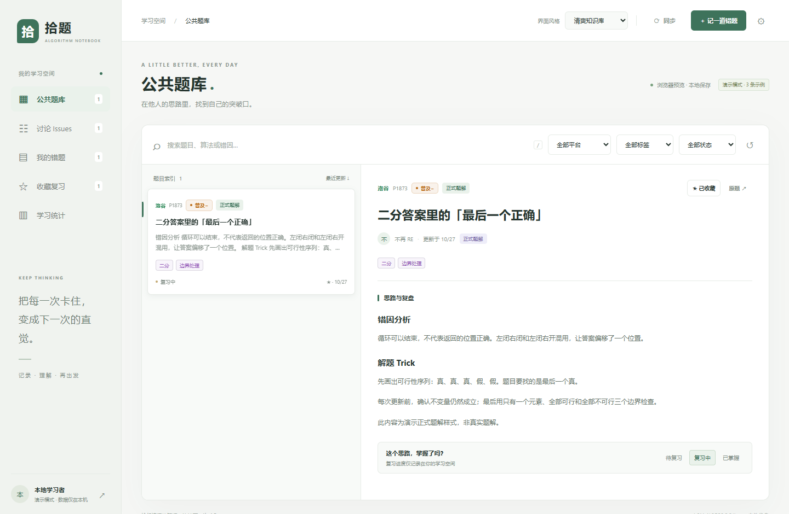

# 拾题 · QMX ACM Notebook

面向 ACM 集训队的 Windows、Linux 与 macOS 本地错题与算法资料客户端，无需自建服务器、数据库或域名。默认资料来源：[qmx-acm-data/2026](https://github.com/qmx-acm-data/2026)。

**[下载 Windows x64 安装包 v0.6.0](https://github.com/qmx-acm-data/qmx-acm-notebook/releases/download/v0.6.0/QMX-Notebook-Setup-0.6.0.exe)** · [所有版本](https://github.com/qmx-acm-data/qmx-acm-notebook/releases)

下载后运行安装程序。首次配置、登录、数据备份与已知限制见 [使用指南](docs/USAGE.md)。当前为预览版，客户端 OAuth 在线投稿尚未完成验收。

## 能做什么

- 正式题库展示 Markdown 题解与算法资料，Issues 在独立交流区展示。
- 管理标记为“仅本地”的题解、草稿、收藏与复习状态，本地编辑删除不影响 GitHub。
- GitHub 登录提供账号身份；直接上传题解文件，在客户端修改、删除本人已上传题解，不创建重复 Issue 或 PR。
- 账户界面检查更新，发现公开正式新版后自动下载校验、备份个人数据，在原位置静默升级并重启，保留已有快捷方式。
- 旧版首次需手动安装 0.3.0，之后可通过客户端检查更新。
- 展示 Markdown、公式、代码与平台原生难度，提供三种界面风格。

## 文档

- [使用指南](docs/USAGE.md)：安装、OAuth 登录、同步格式、数据安全与限制。
- [参与开发](CONTRIBUTING.md)：开发环境、检查与构建命令、贡献约定。
- [维护与发布](docs/RELEASING.md)：源码上传、版本发布、验收状态及应用归属。

## 源码目录

| 目录 | 职责 |
| --- | --- |
| `electron/` | 主进程、GitHub API、凭据与 IPC |
| `ui/` | 无 Node 权限的中文界面 |
| `tests/` | 数据处理与界面验证脚本 |
| `tools/` | Windows 打包工具 |
| `.github/workflows/` | 源码检查、Windows 构建与草稿发布 |
| `docs/` | 使用与维护文档 |

客户端发布仓库为 [qmx-acm-data/qmx-acm-notebook](https://github.com/qmx-acm-data/qmx-acm-notebook)。许可证状态与维护责任见 [维护与发布](docs/RELEASING.md#归属与许可证)。
